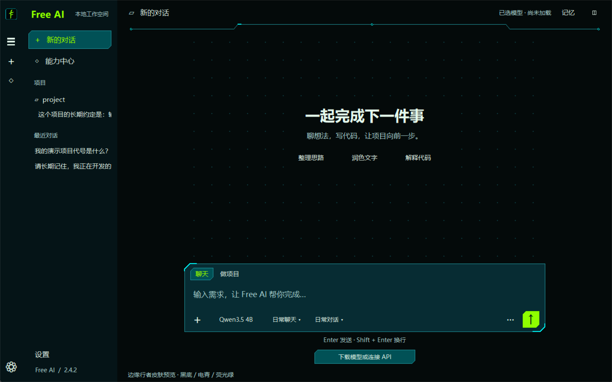

# Free AI

免费的 AI 客户端与独立训练端。当前版本：**2.8.0**，包含边缘行者主题、长期记忆和可在聊天中连续工作的项目助手。



## 运行

适用于 Windows x64。将仓库完整克隆到非 C 盘，例如 `D:\FreeAI`，然后打开：

- **Free AI.exe**：聊天、长期记忆、项目操作、按需下载模型或连接 API。
- **Free AI Trainer.exe**：准备教学资料、训练、比较结果和核实经验。

仓库保留两个启动程序和 Python 基础运行文件，不需要另外安装 Python。请保留整个目录结构；只下载单个 EXE 无法运行。启动不会自动下载或加载模型，也不附带任何人的聊天、长期记忆、API 配置或训练成果。

也可以使用带 Tcl/Tk 的 Python 3.11 从源码启动：

```powershell
python free_ai_bootstrap.py
python free_ai_bootstrap.py --trainer
```

界面和计算、JSON 检查、CSV 统计工具使用 Python 标准库。聊天模型、推理引擎、显卡加速和训练依赖按需安装；不要把系统 Python 环境与独立训练环境混用。

## 当前能力

- **在线准备训练资料**：训练端“准备练习题 → 联网找训练数据”直接显示 6 个带中文用途的推荐数据集，包括中文问答、英文入门、代码、数学和人工对话。搜索支持中文用途、部分名称、分隔符差异和常见近似拼写；输入时只筛选本地下拉建议，点击搜索才查询 Hugging Face，结果按相关度排序。选择后自动预览，核对数量与字段再点“下载训练数据”。一次读取 20–1,000 个源行，保留来源、许可和校验记录；不会自动开始训练。
- **训练端主题与品牌**：默认跟随客户端，可单独选择霓虹、经典深色或明亮。左上角统一为完整的 Free AI，侧栏和按钮按实际字体宽度布局，修复高 DPI 下的截字和下拉框选中文字颜色问题。
- **联网找模型**：在能力中心搜索 Hugging Face 公开模型，选择仓库查看真实 GGUF 文件大小、许可和可下载状态。选中文件后才下载，完成后仍需手动选用。支持匿名可访问、具备完整校验信息的单文件文字 GGUF；第三方模型的运行和工具调用兼容性需实际验证。
- **可调文字与阅读布局**：设置 → 外观提供标准、大、特大字号，即时生效并保留草稿。宽窗口下正文居中、限制行宽，窄窗口下操作按钮换行。训练端共用字号偏好，准备步骤、结果与经验页面均可滚动查看。
- **本地模型或 API**：可下载文字模型，或配置兼容 Chat Completions 的服务。图片、语音和画图等扩展需要另外下载；API 路径目前只处理文字。
- **同一聊天中做项目**：选择项目目录，让助手查看文件、编辑代码、运行测试，并根据结果继续处理。命令默认在聊天中逐条确认；可停止任务或撤回文件工具的修改。
- **可选 DeepSeek Harness 执行组件（实验）**：在设置 → 编程工具选择，按需下载安装约 87 MB 的固定版本组件，沿用聊天里选择的本地模型或 API。在原聊天内显示操作、请求确认、停止和继续会话。默认仍使用内置执行；组件模式的结果显示待验收，暂不支持 Free AI 文件撤回及自动读写长期记忆。[接入与实测说明](development/harness-integration.md)
- **清楚的项目权限**：只看项目、逐条确认命令、自动执行命令三档，随当前对话保存。新对话和切换项目默认逐条确认；运行中不能切换。自动模式由用户明确选择，命令使用 Windows 当前账户权限，文件工具仍限定在所选项目。
- **分类设置与编程工具**：设置页支持搜索，按权限、编程工具、模型与 API、外观、文件位置和关于分类。可保存 VS Code 或自定义编辑器、PowerShell 或命令提示符偏好，并在项目目录打开它们。
- **任务可以接着做**：自动保存计划、文件修改和检查记录。连续续跑会继承累计改动与最近观察，原始记录保留在各轮目录。停止、达到本轮上限或重新打开应用后，可在原任务卡点“继续任务”。恢复会重新核实工作区，按当前权限确认命令；中断的文件写入可通过读回校验恢复，旧版无法自动核实的中断提供人工核实入口。
- **搜索与项目约定**：搜索文本返回文件和行号；自动读取根目录和目标目录祖先的 `AGENTS.md`，修改前向模型提供适用的规范。规范不能扩大操作权限。
- **检查结果独立显示**：明确标为检查的命令才进入验证记录；修改文件或恢复任务后旧检查失效。检查被拒绝、无法启动、失败、计划未完成或修改受阻时，任务保留“仍需处理”和继续入口；无关检查成功不能替代待处理的原检查。
- **查看改动与保留其他人的修改**：在任务详情点“查看改动”，直接对照本轮文件工具的增删。文件被用户或其他程序更新后，AI 必须重新读取；整份覆盖前需读完整份文件，局部替换只能修改已读片段。
- **长期记忆**：手工定义偏好、事实和做法；AI 可直接记下并通知，标为尚未核实。手工记录优先，项目记忆按目录隔离，支持编辑、停用和删除。联网模型读写长期记忆需要单独开启。
- **经验与训练**：长期记忆不等于参数训练；任务经验可以在训练端核实，真正训练使用独立的模型与数据流程。小模型的回复和代码仍需通过实际检查。
- **界面皮肤**：黑底、青色电路、切角面板和荧光绿按钮。在“设置 → 界面皮肤”可切换边缘行者与经典深色，重新打开生效。训练端默认跟随客户端主题，也可以单独选择霓虹、深色或明亮。

详细操作见 [使用说明](使用说明.md) 和 [安装说明](安装说明.txt)。

任务完成与连续恢复修复的行为、验证范围和开源复用方案见 [修复记录](development/task-recovery.md)。

目前重点是本地项目操作。尚未提供通用网页浏览、桌面点击或多智能体协作；小模型能完成哪些任务仍取决于模型和实际检查，本轮功能更新没有重新训练模型权重。

## 文件位置

应用默认位于 `D:\FreeAI`。新生成的聊天、长期记忆和训练记录进入 `portable_data`，模型默认进入 `models`；模型位置可以在安装时另选。个人数据、下载文件、密钥配置、机器路径和构建临时文件均由 `.gitignore` 排除。

仓库历史版本曾包含本机数据库和生成记录。当前版本停止跟踪这些文件，但既有 Git 历史没有被重写。

## 检查与构建

```powershell
& '.\Free AI.exe' --self-test
& '.\Free AI Trainer.exe' --self-test
& '.\runtime\python\python.exe' -E -s -B -X utf8 -m unittest discover -s development/tests -p 'test_*.py' -v
```

自检使用隔离数据；真实模型实验在 `development/tests/run_*_experiment.py`，需先在应用里下载相应模型。打包测试依赖准备后的分发目录，未准备时相关项会跳过。

准备分发文件：

```powershell
& '.\development\build_lite.ps1' -PrepareOnly
```

此步骤使用随附 Python 和 Windows .NET C# 编译器生成两个 EXE，分发目录不含模型或个人数据。要生成安装 EXE，还需要自行准备可用的 Inno Setup 编译器：

```powershell
& '.\development\build_lite.ps1' -Compiler 'D:\Tools\Inno Setup\ISCC.exe' -ReleaseDirectory 'D:\FreeAI-Releases'
```

当前本机已验证客户端、训练端、长期记忆和项目流程；**尚未生成本版安装包**。仓库中的两个应用 EXE 是启动入口，不是安装程序。

图标原图和多尺寸资源位于 `assets`，可通过 `development/export_icon.ps1` 重新导出。Python 及随附运行库保留其许可证；按需下载的模型和引擎遵循各自许可，来源、版本与校验信息见 `capability_catalog.json`。
